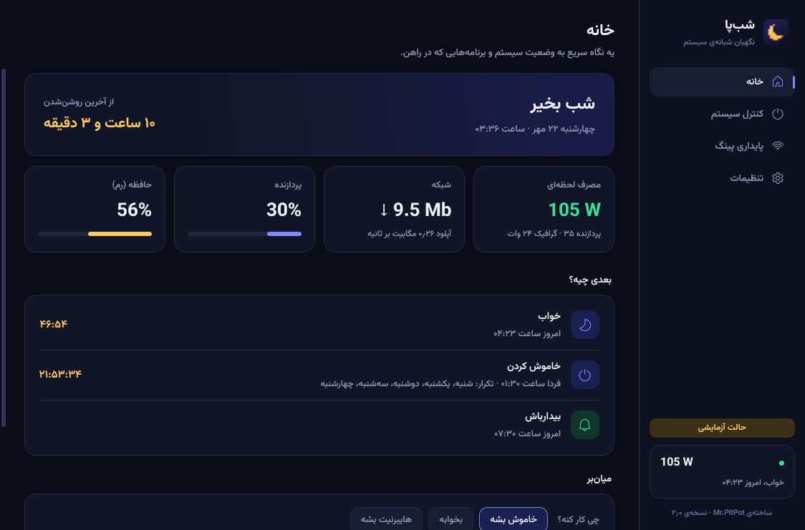
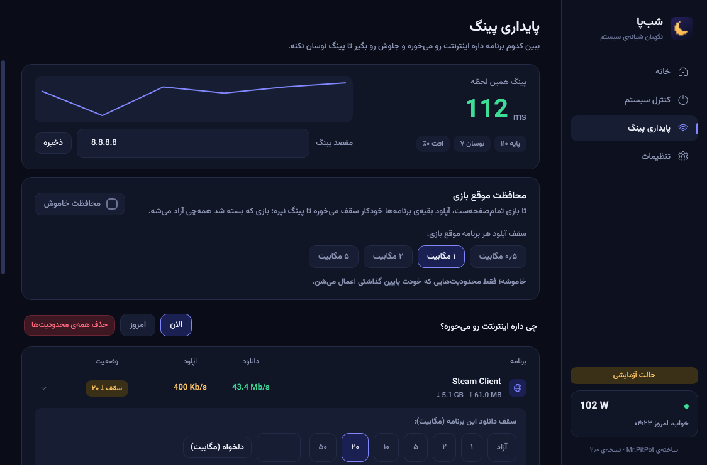
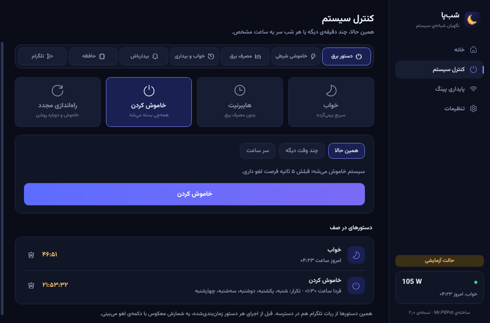
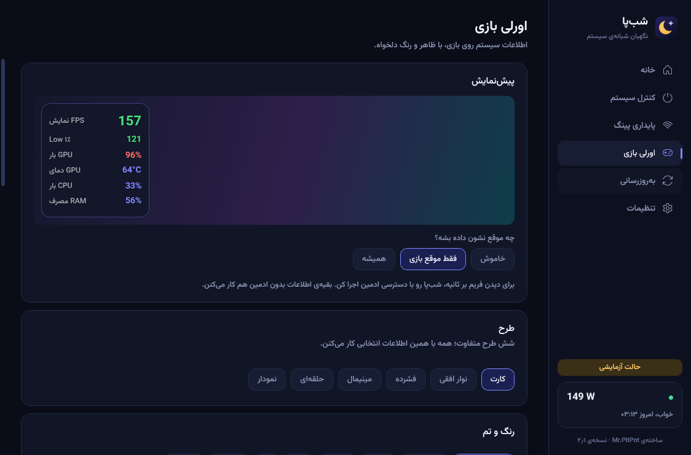
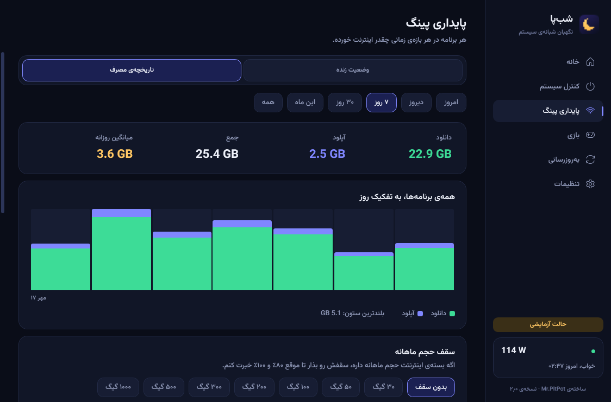
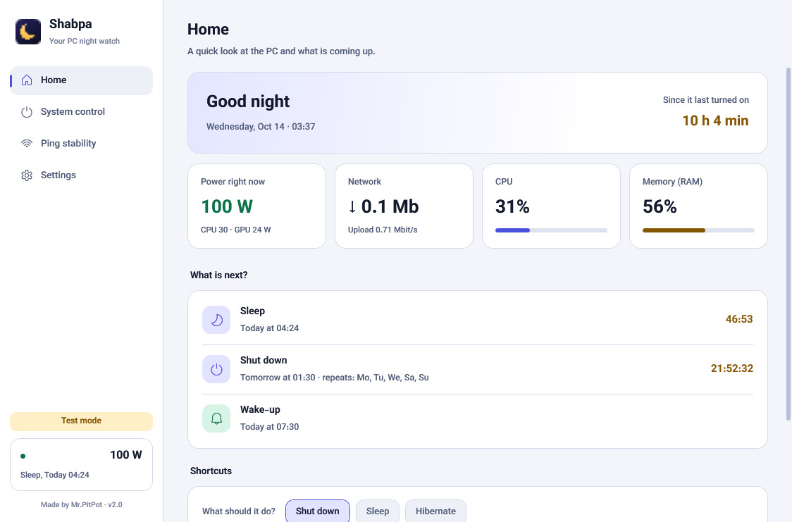
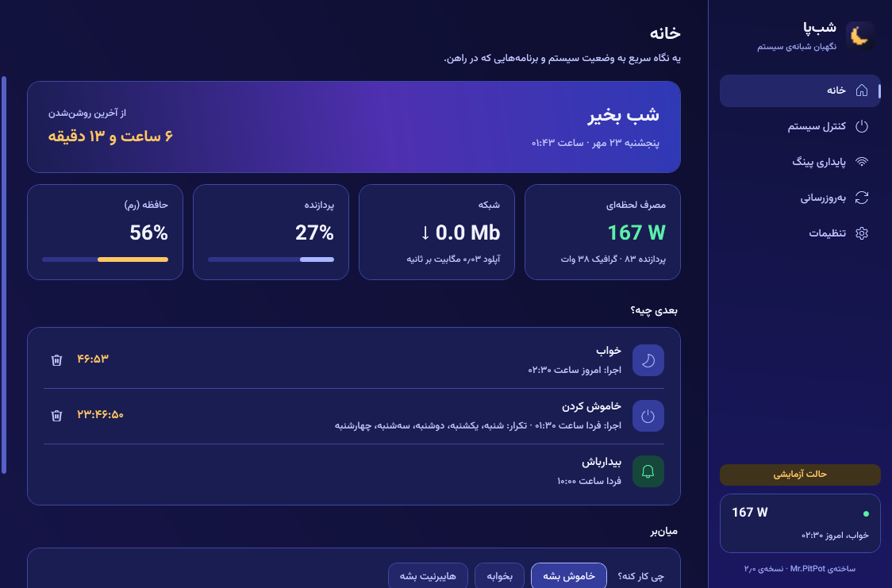
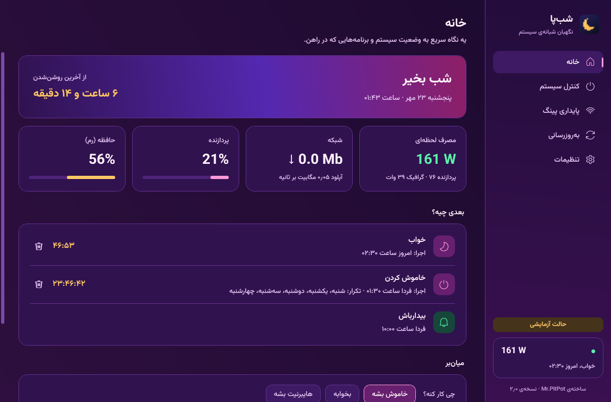

<div align="center">


# شب‌پا · Shabpa

**نگهبان شبانه‌ی ویندوز** — خاموشی زمان‌بندی‌شده، بیدارباش، مصرف برق، پایداری پینگ، محدودیت سرعت هر برنامه، اورلی بازی و خالی کردن رم، توی یه برنامه‌ی سبک فارسی/انگلیسی.

[**⬇️ دانلود آخرین نسخه**](../../releases/latest) · [English](#english)



</div>

## امکانات

- **دستور برق:** خواب، هایبرنیت، خاموش، ری‌استارت؛ همین حالا، چند دقیقه‌ی دیگه یا هر شب سر یه ساعت، با شمارش معکوس و دکمه‌ی لغو.
- **خاموشی شرطی:** وقتی دانلود تموم شد، کار سنگین تموم شد، سیستم بی‌استفاده موند یا یه برنامه بسته شد.
- **بیدارباش:** سیستم سر ساعت از خواب و هایبرنیت بیدار می‌شه.
- **خواب و بیداری:** تاریخچه‌ی روشن و خاموش شدن از لاگ ویندوز، خاموشی‌های ناگهانی، و اینکه چی نمی‌ذاره سیستم بخوابه.
- **مصرف برق:** وات لحظه‌ای، ۳۰ روز گذشته و هزینه به تومان.
- **پایداری پینگ:** پینگ زنده، مصرف شبکه‌ی هر برنامه، سقف دانلود و آپلود یا بستن کامل اینترنت هر برنامه، و محافظت خودکار موقع بازی (سقف آپلود و دانلود).
- **تاریخچه‌ی مصرف اینترنت:** مصرف هر برنامه به تفکیک ساعت و روز، با بازه‌ی امروز، دیروز، ۷ و ۳۰ روز، این ماه و همه؛ و هشدار سقف حجم ماهانه.
- **اورلی بازی:** فریم بر ثانیه، ۱٪ پایین، نمودار FPS، دما/کلاک/توان/ولتاژ/فن کارت گرافیک، بار و فرکانس پردازنده، رم و پینگ و سرعت شبکه روی بازی؛ ۶ طرح، رنگ و اندازه‌ی کاملاً دلخواه، میان‌بر کیبورد. چیزی داخل بازی تزریق نمی‌شه.
- **وضعیت زنده‌ی سیستم** توی صفحه‌ی خانه: کارت گرافیک، پردازنده، حافظه و شبکه با نام قطعه و مقدار درگیری (AMD و NVIDIA).
- **آب و هوا:** جستجوی شهر (فارسی یا انگلیسی) با پیشنهاد، هوای الان، ساعت‌های بعد و ۸ روز آینده، با پس‌زمینه‌ی متحرک (باران، برف، آفتاب، ابر، ستاره، مه، رعد و برق). منبع: Open-Meteo.
- **دی‌ان‌اس:** لیست آماده‌ی دی‌ان‌اس‌ها (ایران و دور زدن تحریم، عمومی، امنیتی) با پینگ زنده، اعمال روی کارت شبکه با تایید از ویندوز، برگشت به حالت خودکار و افزودن دی‌ان‌اس دلخواه.
- **دانلود زمان‌بندی‌شده:** لانچرهای نصب‌شده (Steam، Epic، Riot، EA، Ubisoft، GOG، Battle.net) رو با اجازه‌ی خودت پیدا می‌کنه، توی ساعت مشخص بازشون می‌کنه و وقتی دانلود تموم شد سیستم رو خاموش (یا خواب) می‌کنه.
- **حسگرهای پیشرفته (اختیاری):** دمای واقعی CPU، دور و درصد فن CPU و داده‌های کارت‌های هر برند، با دسترسی ادمین و درایور PawnIO.
- **گزارش بعد از بازی:** مدت، میانگین فریم، پینگ، دمای کارت و حجم اینترنت بازی.
- **حافظه:** خالی کردن رم و کش رم، دستی یا خودکار.
- **کنترل از تلگرام** با ربات شخصی خودت، و **به‌روزرسانی** از توی برنامه یا ربات.
- **ایمنی:** هر زمان‌بندی، حذف، قفل و خالی کردن رم با زمان دقیق تایید می‌گیره؛ بعد از خاموش یا خواب شدن، دستورهای باقی‌مونده پاک می‌شن و هیچ دستوری وقتی سیستم خاموش یا خواب بود دیرهنگام اجرا نمی‌شه.
- فارسی و انگلیسی، ۱۱ تم رنگی (آبی شب، مشکی، سفید، صورتی، بنفش، سبز، بنفش‌آبی، صورتی‌بنفش، غروب، اقیانوس، شفق).

<p>







</p>

## نصب

از صفحه‌ی [Releases](../../releases/latest) فایل `ShabpaSetup.exe` رو بگیر و اجرا کن (ویندوز ۱۰ یا ۱۱، ۶۴ بیتی). اگه سیستم ‎.NET 10 نداشته باشه، نصب‌کننده نسخه‌ی رسمیش رو از سایت مایکروسافت می‌گیره و نصب می‌کنه.

**درباره‌ی هشدار ویندوز و آنتی‌ویروس:** فایل‌ها امضای دیجیتال پولی ندارن، پس ویندوز ممکنه بگه «Windows protected your PC»؛ روی *More info* و بعد *Run anyway* بزن. بعضی آنتی‌ویروس‌ها درایور WinDivert (برای محدودیت سرعت) رو به‌عنوان «ابزار شبکه» علامت می‌زنن. کل سورس اینجاست و هر کس می‌تونه خودش بسازدش؛ کد SHA-256 هر فایل هم کنار هر نسخه منتشر می‌شه.

**حریم خصوصی:** همه‌چی فقط روی همین سیستم ذخیره می‌شه (`%AppData%\Shabpa`). برنامه به جایی داده نمی‌فرسته؛ تنها ارتباط‌هاش بررسی نسخه‌ی جدید از GitHub، پینگ به مقصدی که خودت تعیین می‌کنی، و ربات تلگرام خودت (اگه فعالش کنی) هستن.

## ساختن از روی سورس

پیش‌نیاز: [.NET 10 SDK](https://dotnet.microsoft.com/download) و Git Bash.

```bash
dotnet test Shabpa.slnx          # تست‌ها
bash build-installer.sh           # ساخت installer/ShabpaSetup.exe
```

| پوشه | چی داره |
|---|---|
| `src/Shabpa` | خود برنامه (WPF، ‎.NET 10). منطق در `Core/`، صفحه‌ها در `Pages/` |
| `src/Setup` | نصب‌کننده (‎.NET Framework 4.8 که با ویندوز میاد) |
| `tools/Packer` | فشرده کردن فایل‌های برنامه برای نصب‌کننده |
| `tests` | تست‌های خودکار |

حالت‌های کمکی برنامه: `--dry-run` (دستورهای برق فقط شبیه‌سازی می‌شن)، `--demo`، `--diagnose report.txt` (همه‌ی بخش‌ها رو روی همین سیستم امتحان می‌کنه)، `--screenshots <folder>`.

---

<a id="english"></a>

## English

**Shabpa** ("night watch") is a small Windows 10/11 utility, in Persian and English:

- scheduled and conditional **sleep / hibernate / shutdown / restart** (when a download finishes, when the PC is idle, when a program closes), always with a cancellable countdown;
- **wake timers** that bring the PC out of sleep or hibernation;
- **sleep & wake history** from the Windows event log, and what is keeping the PC awake;
- **power use** in watts, last 30 days and cost;
- **ping stability:** live ping, per-app network usage, per-app **download/upload caps or a full block** (via [WinDivert](https://github.com/basil00/WinDivert)), and automatic in-game upload *and* download caps;
- **usage history:** per-app internet use by hour and day over any period, plus a monthly allowance warning;
- **in-game overlay:** FPS, 1 % low, GPU temperature/clock/power, CPU, RAM and ping, in six layouts with fully custom colours, size and position; nothing is injected into games;
- **live system status** on the home page: graphics card, processor, memory and network with part names and load (AMD, NVIDIA);
- **weather:** city search (Persian or English) with suggestions, now / next hours / 8 days, animated backdrop (rain, snow, sun, clouds, stars, fog, lightning). Source: Open-Meteo;
- **DNS:** a ready list of DNS servers (Iran / sanction bypass, public, secure) with live ping, apply to your adapter (confirmed by Windows), back to automatic, and your own entries;
- **scheduled download:** finds installed launchers (Steam, Epic, Riot, EA, Ubisoft, GOG, Battle.net) with your permission, opens one at a set time and shuts the PC down when its download is done;
- **advanced sensors (optional):** real CPU temperature, CPU fan speed and any-brand graphics-card readings, with administrator rights and the PawnIO driver;
- **game report** after each session, **RAM cleanup**, and an explicit confirmation (with the exact time) before anything is scheduled, deleted or run;
- remote control and updates through **your own Telegram bot**; eleven colour themes.

Graphics readings are verified on an AMD Radeon RX 6900 XT. NVIDIA readings use the driver's NVML library and have not been tested on real NVIDIA hardware yet. CPU fan speed and memory temperature need a hardware-sensor driver and are not available yet.

Download `ShabpaSetup.exe` from [Releases](../../releases/latest). The binaries are not code-signed, so SmartScreen may warn; some antivirus products flag the WinDivert driver as a network tool. Everything stays on your PC.

Build: `dotnet test Shabpa.slnx`, then `bash build-installer.sh`.

## License

MIT, see [LICENSE](LICENSE). Bundled third-party components (WinDivert, Vazirmatn font, TraceEvent) keep their own licenses, see [THIRD-PARTY-NOTICES.md](THIRD-PARTY-NOTICES.md).

Made by Mr.PitPot.
