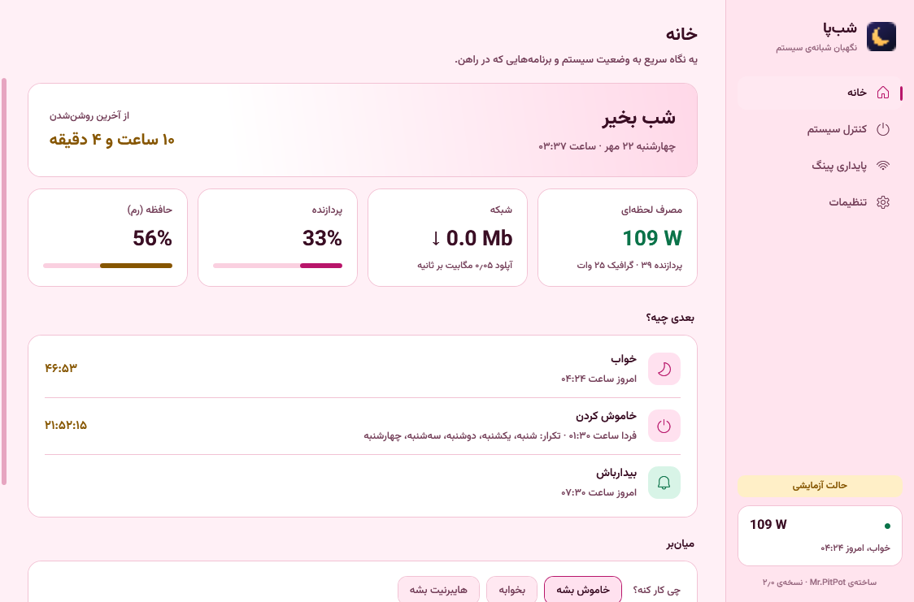

<div align="center">


# شب‌پا · Shabpa

**نگهبان شبانه‌ی ویندوز** — خاموشی زمان‌بندی‌شده، بیدارباش، مصرف برق، پایداری پینگ، محدودیت سرعت هر برنامه و خالی کردن رم، توی یه برنامه‌ی سبک فارسی/انگلیسی.

[**⬇️ دانلود آخرین نسخه**](../../releases/latest) · [English](#english)


</div>

## امکانات

- **دستور برق:** خواب، هایبرنیت، خاموش، ری‌استارت؛ همین حالا، چند دقیقه‌ی دیگه یا هر شب سر یه ساعت، با شمارش معکوس و دکمه‌ی لغو.
- **خاموشی شرطی:** وقتی دانلود تموم شد، کار سنگین تموم شد، سیستم بی‌استفاده موند یا یه برنامه بسته شد.
- **بیدارباش:** سیستم سر ساعت از خواب و هایبرنیت بیدار می‌شه.
- **خواب و بیداری:** تاریخچه‌ی روشن و خاموش شدن از لاگ ویندوز، خاموشی‌های ناگهانی، و اینکه چی نمی‌ذاره سیستم بخوابه.
- **مصرف برق:** وات لحظه‌ای، ۳۰ روز گذشته و هزینه به تومان.
- **پایداری پینگ:** پینگ زنده، مصرف شبکه‌ی هر برنامه، سقف دانلود و آپلود یا بستن کامل اینترنت هر برنامه، و محافظت خودکار موقع بازی.
- **حافظه:** خالی کردن رم و کش رم، دستی یا خودکار.
- **کنترل از تلگرام** با ربات شخصی خودت، و **به‌روزرسانی** از توی برنامه یا ربات.
- فارسی و انگلیسی، ۶ تم رنگی (آبی شب، مشکی، سفید، صورتی، بنفش، سبز).

<p>



</p>

## نصب

از صفحه‌ی [Releases](../../releases/latest) فایل `ShabpaSetup.exe` رو بگیر و اجرا کن (ویندوز ۱۰ یا ۱۱، ۶۴ بیتی). اگه سیستم ‎.NET 10 نداشته باشه، نصب‌کننده نسخه‌ی رسمیش رو از سایت مایکروسافت می‌گیره و نصب می‌کنه.

**درباره‌ی هشدار ویندوز و آنتی‌ویروس:** فایل‌ها امضای دیجیتال پولی ندارن، پس ویندوز ممکنه بگه «Windows protected your PC»؛ روی *More info* و بعد *Run anyway* بزن. بعضی آنتی‌ویروس‌ها درایور WinDivert (برای محدودیت سرعت) رو به‌عنوان «ابزار شبکه» علامت می‌زنن. کل سورس اینجاست و هر کس می‌تونه خودش بسازدش؛ کد SHA-256 هر فایل هم کنار هر نسخه منتشر می‌شه.

**حریم خصوصی:** همه‌چی فقط روی همین سیستم ذخیره می‌شه (`%AppData%\Shabpa`). برنامه به جایی داده نمی‌فرسته؛ تنها ارتباط‌هاش بررسی نسخه‌ی جدید از GitHub، پینگ به مقصدی که خودت تعیین می‌کنی، و ربات تلگرام خودت (اگه فعالش کنی) هستن.

## ساختن از روی سورس

پیش‌نیاز: [.NET 10 SDK](https://dotnet.microsoft.com/download) و Git Bash.

```bash
dotnet test Shabpa.slnx          # تست‌ها
bash build-installer.sh           # ساخت installer/ShabpaSetup.exe
```

| پوشه | چی داره |
|---|---|
| `src/Shabpa` | خود برنامه (WPF، ‎.NET 10). منطق در `Core/`، صفحه‌ها در `Pages/` |
| `src/Setup` | نصب‌کننده (‎.NET Framework 4.8 که با ویندوز میاد) |
| `tools/Packer` | فشرده کردن فایل‌های برنامه برای نصب‌کننده |
| `tests` | تست‌های خودکار |

حالت‌های کمکی برنامه: `--dry-run` (دستورهای برق فقط شبیه‌سازی می‌شن)، `--demo`، `--diagnose report.txt` (همه‌ی بخش‌ها رو روی همین سیستم امتحان می‌کنه)، `--screenshots <folder>`.

---

<a id="english"></a>

## English

**Shabpa** ("night watch") is a small Windows 10/11 utility, in Persian and English:

- scheduled and conditional **sleep / hibernate / shutdown / restart** (when a download finishes, when the PC is idle, when a program closes), always with a cancellable countdown;
- **wake timers** that bring the PC out of sleep or hibernation;
- **sleep & wake history** from the Windows event log, and what is keeping the PC awake;
- **power use** in watts, last 30 days and cost;
- **ping stability:** live ping, per-app network usage, per-app **download/upload caps or a full block** (via [WinDivert](https://github.com/basil00/WinDivert)), and an automatic in-game upload cap;
- **RAM cleanup** (working sets and standby cache);
- remote control and updates through **your own Telegram bot**; six colour themes.

Download `ShabpaSetup.exe` from [Releases](../../releases/latest). The binaries are not code-signed, so SmartScreen may warn; some antivirus products flag the WinDivert driver as a network tool. Everything stays on your PC.

Build: `dotnet test Shabpa.slnx`, then `bash build-installer.sh`.

## License

MIT, see [LICENSE](LICENSE). Bundled third-party components (WinDivert, Vazirmatn font, TraceEvent) keep their own licenses, see [THIRD-PARTY-NOTICES.md](THIRD-PARTY-NOTICES.md).

Made by Mr.PitPot.
