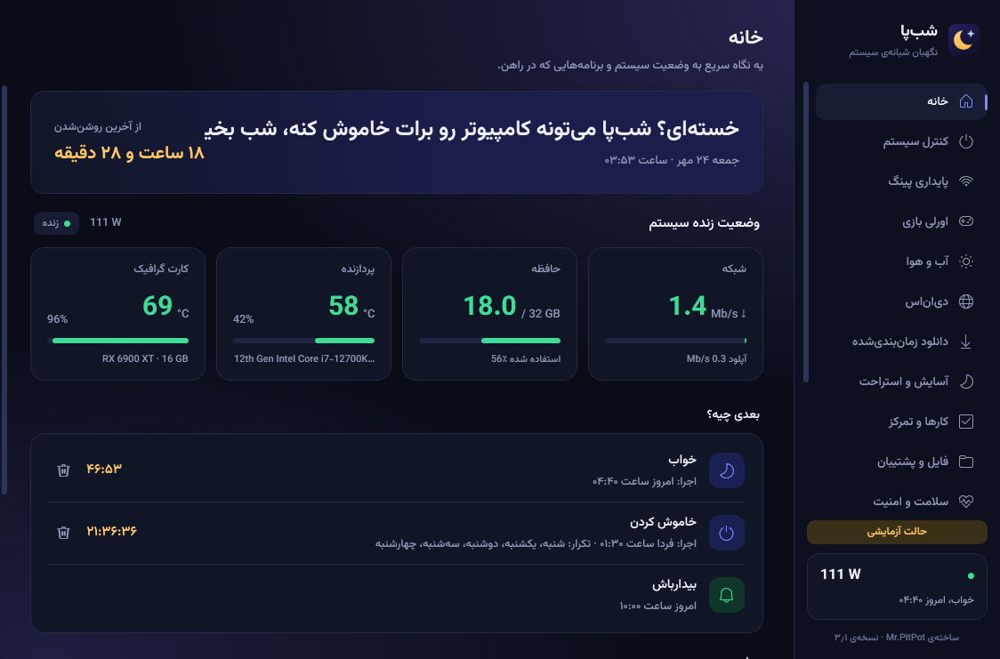
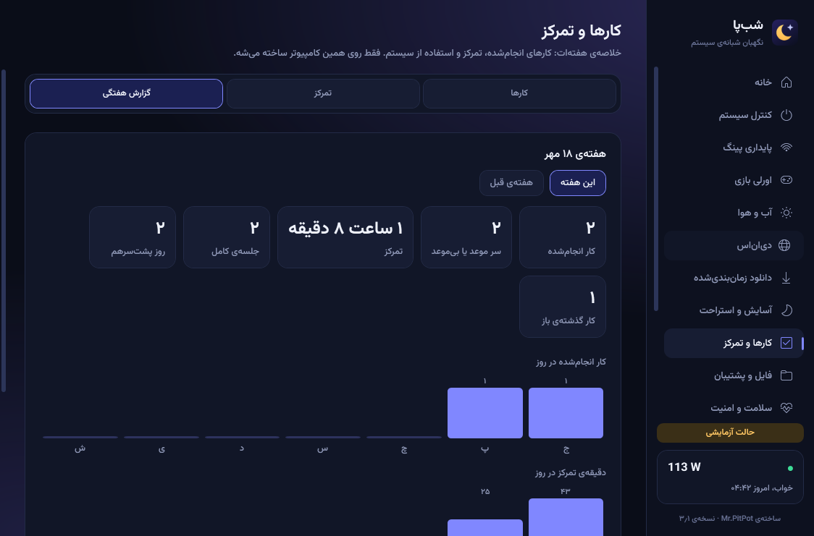
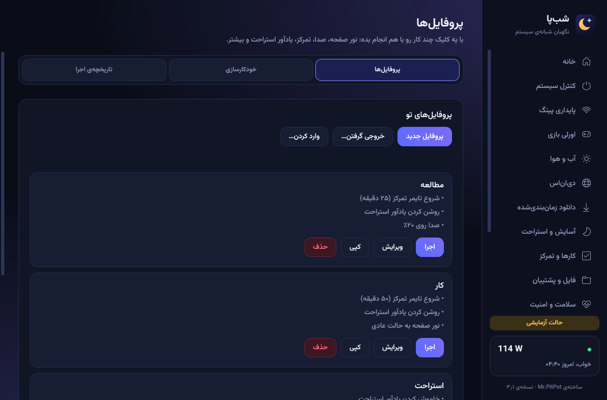
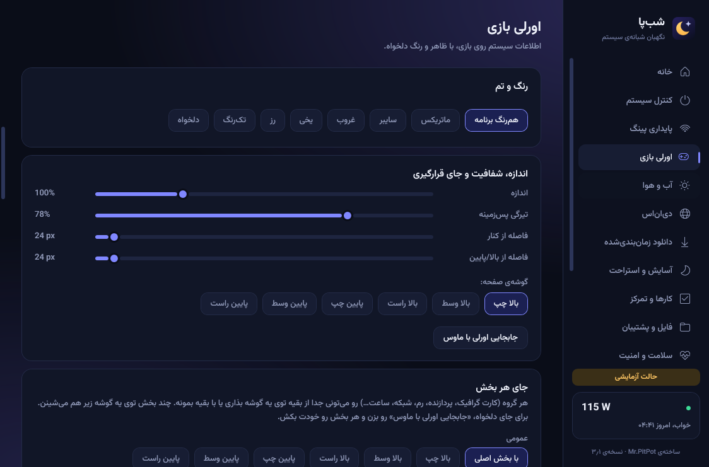
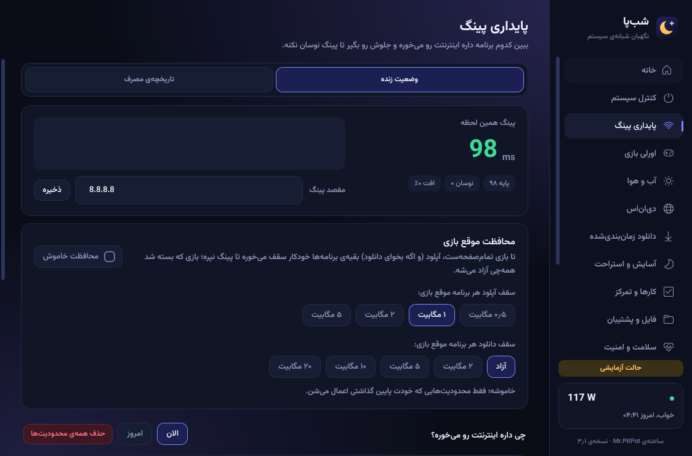
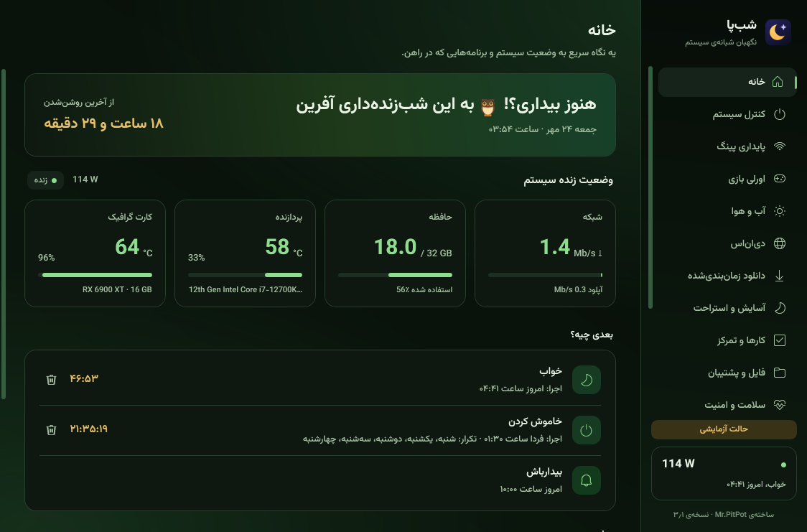
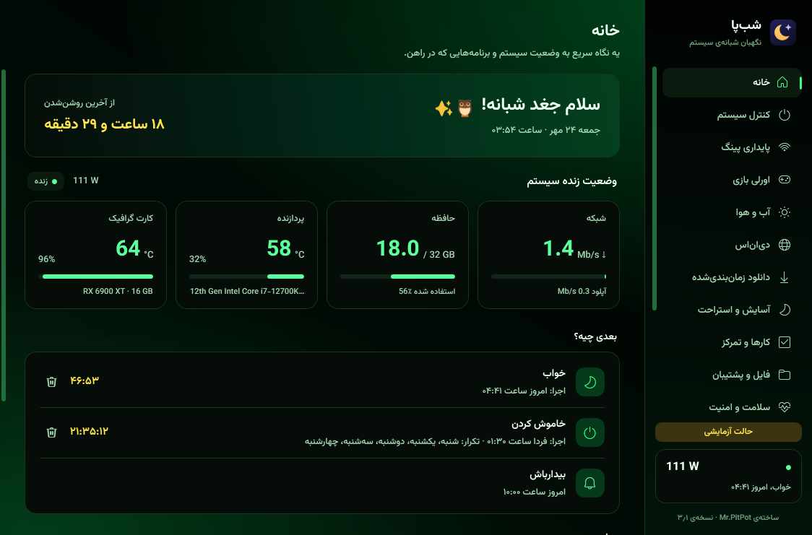
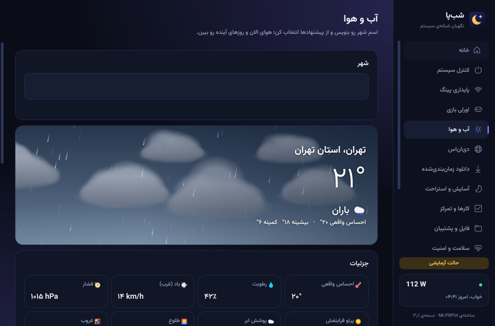
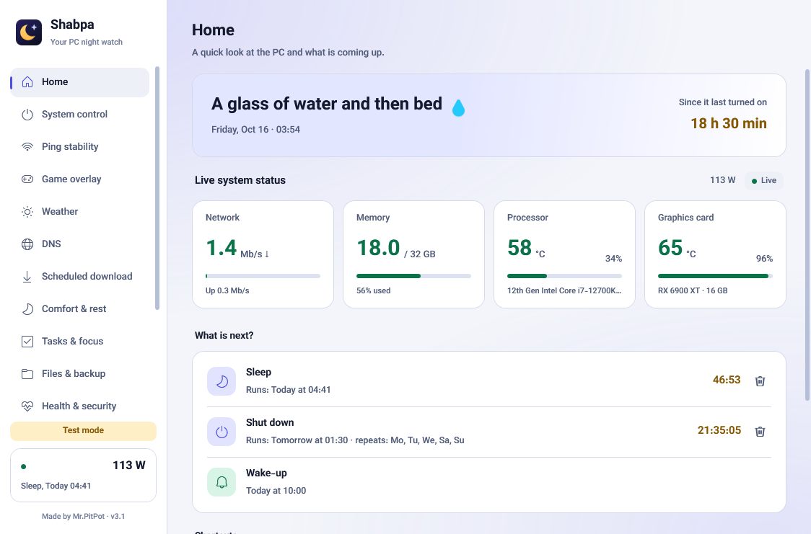

<div align="center">


# Shabpa

**A night watch for your Windows PC** - scheduled power control, gaming overlay, network tools, daily tasks, backups and system health in one light app.

[](https://github.com/MrPitPot/shabpa/releases/latest)
[](https://github.com/MrPitPot/shabpa/actions/workflows/ci.yml)
[](LICENSE)


[**Download**](https://github.com/MrPitPot/shabpa/releases/latest) &nbsp;·&nbsp; [فارسی](README.fa.md) &nbsp;·&nbsp; [Changelog](CHANGELOG.md)



</div>

Shabpa started as a shutdown timer and grew into an everyday Windows assistant. It runs in the tray, keeps
your data on your PC, and speaks Persian and English with 21 colour themes.

## Features

| Area | What you get |
|---|---|
| **Power** | Sleep, hibernate, shut down and restart now, later or on a schedule, or when a download ends, the PC is idle or a program closes - always with a cancellable countdown. Wake timers. Sleep and wake history. |
| **Tasks & focus** | To-do list with deadlines, reminders and categories; focus and break timer; weekly report. |
| **Files & backup** | Disk space analysis, duplicate finder, temp and cache clean-up, scheduled folder backup with verification and a restore that never overwrites. Deleted files go to the Recycle Bin. |
| **Health & security** | Disk, update and service checks, recent event-log errors in plain language, firewall/Defender/UAC status, startup-program watch, program and driver update checks, redacted report. |
| **Profiles** | One-click profiles (study, work, rest, night) with time or game triggers, run history and undo. |
| **Gaming** | In-game overlay (FPS, 1 % low, GPU, CPU, RAM, ping) in six layouts, per-game profiles, game reports, game mode. Nothing is injected into games. |
| **Network** | Live ping, per-app traffic, per-app speed caps or blocking, automatic in-game protection, usage history and a monthly allowance, DNS switcher. |
| **Night light & rest** | Night light with editable Kelvin presets, screen dimmer below the monitor's minimum, break reminders, sleep mode, microphone level and noise test. |
| **Weather** | City search, hourly and 8-day forecast, animated sky. |
| **Remote** | Control from Telegram through `@ShabPa_Bot` with a one-time code. |

<p>








</p>

## Install

Download `ShabpaSetup.exe` from the [latest release](https://github.com/MrPitPot/shabpa/releases/latest) and run it
(Windows 10 or 11, 64-bit). If .NET 10 is missing, the installer fetches Microsoft's official runtime. The SHA-256 of
every installer is published next to it.

Code signing: the binaries are currently not signed (a free SignPath Foundation application was not accepted), so SmartScreen may warn; see the [code signing policy](CODE_SIGNING_POLICY.md). Verify the SHA-256 published next to each release. If SmartScreen warns: choose **More info -> Run anyway**. Some antivirus
products flag the bundled [WinDivert](https://github.com/basil00/WinDivert) driver (used for per-app speed limits)
as a network tool. All source is here to read and build.

## Privacy and safety

- Everything is stored locally in `%AppData%\Shabpa`. There is no account and no telemetry.
- Only things you switch on use the internet: the update check (GitHub), weather (Open-Meteo), the Telegram link
  and support tickets.
- Telegram control is opt-in. The app asks for a one-time code; it never sees a Telegram token.
- Every schedule, deletion, lock or clean-up shows its exact effect and asks first. Your files are removed only
  through the Recycle Bin, after a preview, and only from the folder you scanned; clean-up touches temporary and cache
  folders only.
- Commands that arrive late (the PC was off or asleep) are dropped, never run by surprise.

Details are in [SECURITY.md](SECURITY.md).

## Build from source

Requires the [.NET 10 SDK](https://dotnet.microsoft.com/download) and Git Bash.

```bash
dotnet test Shabpa.slnx        # run the test suite
bash build-installer.sh        # produce installer/ShabpaSetup.exe
```

| Path | Contents |
|---|---|
| `src/Shabpa` | The app (WPF, .NET 10). Logic in `Core/`, screens in `Pages/` |
| `src/Setup` | The installer |
| `tools/Packer` | Packs the app files for the installer |
| `tests` | Automated tests |
| `server` | Optional Cloudflare Worker for support tickets |
| `docs` | Screenshots |

Useful switches: `--dry-run` simulates power commands, `--demo` uses sample data, `--screenshots <folder>` captures every screen.

## Contributing

Bug reports and ideas are welcome through [issues](https://github.com/MrPitPot/shabpa/issues); see
[CONTRIBUTING.md](CONTRIBUTING.md) before opening a pull request.

## License

MIT - see [LICENSE](LICENSE). Bundled third-party components keep their own licenses, listed in
[THIRD-PARTY-NOTICES.md](THIRD-PARTY-NOTICES.md).

Made by [Mr.PitPot](https://github.com/MrPitPot).
